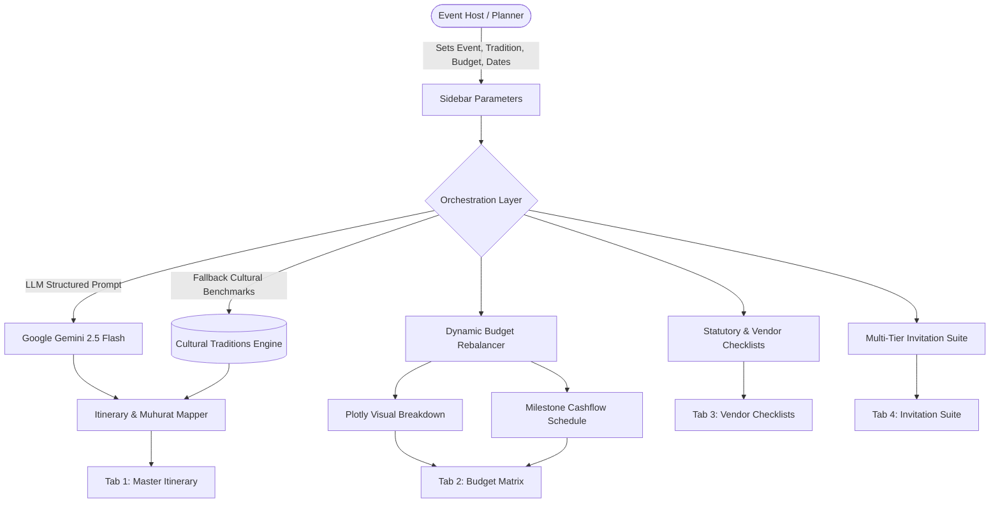

# 🪔 UtsavAI – The Cultural & Multi-Scale Event Architect

> **PromptWars 2026 Submission** | A GenAI-powered cultural event planning assistant designed to handle the intricate nuances of multi-day cultural events (Indian weddings, milestone anniversaries, community festivals).

[](https://streamlit.io)
[](https://www.python.org/)
[](https://ai.google.dev/)
[](LICENSE)

---

## 1. Project Overview & Core Value Proposition

Cultural events—such as multi-day Indian weddings, milestone anniversaries, and community galas—involve hundreds of interdependent rituals, strict muhurat timings, complex multi-tier guest expectations, and volatile budgets. Generic planning spreadsheets fail because they lack:
1. **Cultural Sub-Tradition Literacy:** Understanding the distinct vidhis and sequence across traditions (Gujarati, Punjabi, South Indian, Bengali, Marwari, Fusion).
2. **Auspicious Muhurat & Ritual Mapping:** Timing ceremonies based on tradition, daylight, and practical vendor setup buffers.
3. **Dynamic Budget Rebalancing:** Automatically adjusting remaining budget allocations when one category (e.g., catering or venue) changes.
4. **Statutory & Vendor Accountability:** Clear permit roadmaps (police sound permits, fire NOCs, music licenses) and vendor contract negotiation safeguards.

**UtsavAI** solves this with an end-to-end architectural planning engine powered by structured LLM orchestration and dynamic financial modeling.

---

## 2. Key Features & Functional Modules

### 📅 1. Auspicious Timeline & Ritual Mapper
- Takes event type, cultural tradition, start date, scale, and venue style.
- Generates a day-by-day, hour-by-hour schedule including sacred vidhis, significance, dress codes, and operational instructions.
- Exportable to structured JSON.

### 💰 2. Smart Dynamic Budget Rebalancer
- Allocates capital across key pillars:
  - **Venue & Stays** (28%–38%)
  - **Catering & Delicacies** (25%–35%)
  - **Decor & Mandap Art** (14%–22%)
  - **Photography & Film** (8%–14%)
  - **Attire & Trousseau** (5%–10%)
  - **Entertainment & Logistics** (4%–10%)
  - **Buffer Reserve** (2%–5%)
- Allows category overrides with **automatic proportional rebalancing** of remaining pillars.
- Provides milestone cash-flow timeline (Booking Deposit, Production Milestone, Pre-Event Liquidity, Post-Event Settlement).

### 📋 3. Localized Vendor & Logistics Checklist
- **Statutory Permits:** Loudspeaker police permissions (post 10 PM), PPL/IPRS music licensing, Fire NOC, and DGCA drone clearance.
- **Vendor Technical Questionnaires & SLAs:** Essential interview questions and contract penalty clauses for caterers, decor architects, and cinematographers.
- **Pooja Samagri Kit:** Categorized traditional samagri lists.
- **Weather & Seasonal Protocol:** Monsoon, summer misting, and winter heating contingencies.

### 💌 4. Personalized Guest Tier & Invitation Suite
- Segregates guests into 3 distinct tiers:
  - **Tier 1:** Elders & Sacred Family Circle (Traditional Vedic invocation, respectful blessing tone)
  - **Tier 2:** Friends & Entourage (High-energy, Sangeet & after-party focus)
  - **Tier 3:** Professional Network & Colleagues (Polished, formal banquet invitation)
- Formats each tier into **Digital Card Copy**, **WhatsApp Broadcast (with emojis)**, and **Formal Email**.

---

## 3. Architecture & Data Flow



---

## 4. Prompt Engineering Architecture

UtsavAI leverages strict JSON schema validation, zero-shot role-conditioned prompting, and multi-turn financial rebalancing chains to prevent hallucinations and guarantee mathematical integrity.

### Module 1: The Cultural Timeline & Muhurat Generator
```text
System: You are the world's leading Cultural Event Architect & Muhurat Specialist for large-scale Indian & fusion celebrations.
Generate a structured, authentic {days}-day itinerary for:
- Event: {event_type}
- Tradition/Culture: {tradition}
- Expected Guests: {guest_count}
- Dietary Style: {dietary}
- Venue Type: {venue_type}

Output Format: Strict JSON object containing overview and an array of rituals with day, timing, ritual name, significance, dress code, and operational notes.
```

### Module 2: The Smart Dynamic Budget Rebalance Chain
```text
System: You are an event financial comptroller and luxury celebration budgeting strategist.
Analyze the target budget and guest scale, then allocate capital across Venue, Catering, Decor, Photography, Attire, Entertainment, and Buffer.
Ensure the sum of categories strictly equals the target budget and returns structured line items with cultural benchmark ranges.
When host provides adjustments, dynamically rebalance non-locked categories to preserve mathematical equality.
```

### Module 3: Time-Phased Task Dependency & Crisis Protocols
```text
System: You are an event crisis director. Generate a time-phased execution dependency matrix (T-60 to T-30, T-14 to T-7, T-48 Hours, Day-Of) along with technical contingency failovers for high-risk scenarios (rain on open lawns, generator blackout, food surge, noise curfew post 10 PM, havan smoke safety).
```

---

## 5. Live Application & Demo Video

- 🌐 **Live Deployed App:** [https://utsavai.streamlit.app](https://utsavai.streamlit.app) *(or your Streamlit Community Cloud URL)*
- 🎥 **Walkthrough Demo Video (< 4 Mins):** [Watch Demo on YouTube / Loom](https://youtu.be/your-demo-video-link)
- 💻 **GitHub Repository:** [https://github.com/Tirth3929v/utsavai](https://github.com/Tirth3929v/utsavai)

---

## 6. Quick Start & Local Execution

### Prerequisites
- Python 3.10+ installed
- Git installed

### 1. Clone & Navigate
```bash
git clone https://github.com/Tirth3929v/utsavai.git
cd utsavai
```

### 2. Create & Activate Virtual Environment
```bash
# Using uv (recommended)
uv venv .venv
.venv\Scripts\activate      # Windows
# or: source .venv/bin/activate  # macOS/Linux

# Using standard venv
python -m venv .venv
.venv\Scripts\activate
```

### 3. Install Dependencies
```bash
pip install -r requirements.txt
# or: uv pip install -r requirements.txt
```

### 4. Configure Environment (Optional)
```bash
cp .env.example .env
# Add your GEMINI_API_KEY to .env (or enter it in the app sidebar)
```

### 5. Launch Application
```bash
streamlit run app.py
```
Open your browser at `http://localhost:8501`.

---

## 7. Streamlit Community Cloud Deployment Guide

Follow these steps to deploy **UtsavAI** to the web in under 2 minutes:

1. **Sign in to Streamlit Cloud:**
   - Navigate to [share.streamlit.io](https://share.streamlit.io) and sign in with your GitHub account.

2. **Create New App:**
   - Click **"New app"** (or **"Create app"**).
   - **Repository:** `Tirth3929v/utsavai`
   - **Branch:** `main`
   - **Main file path:** `app.py`
   - **App URL:** Customize if desired (e.g., `utsavai.streamlit.app`).

3. **Configure Secrets (Optional & Recommended):**
   - Click **Advanced Settings** before launching (or go to **App Settings > Secrets**).
   - Enter your Gemini API key in TOML format:
     ```toml
     GEMINI_API_KEY = "your-google-gemini-api-key-here"
     ```
   - Click **Save**.

4. **Deploy & Verify:**
   - Click **Deploy!**
   - Streamlit will automatically install dependencies from `requirements.txt` and launch your festive event architect live!

---

## 8. Project Structure

```
utsavai/
├── app.py                     # Streamlit frontend & dashboard UI
├── requirements.txt           # Python dependencies
├── .gitignore                 # Git ignore rules
├── .env.example               # Environment variables template
├── README.md                  # Comprehensive project documentation
├── .streamlit/
│   ├── config.toml            # Modern dark festive theme palette
│   └── secrets.toml.example   # Secrets template for Streamlit Cloud
├── config/
│   ├── __init__.py
│   └── traditions.py          # Cultural traditions, vidhis & benchmark splits
├── core/
│   ├── __init__.py
│   ├── ai_client.py           # Gemini LLM orchestration with fallback
│   ├── prompts.py             # System prompts, JSON schemas, rebalance chains
│   ├── budget_engine.py       # Dynamic allocation & rebalance math
│   ├── itinerary_engine.py    # Multi-day timeline calculator & exports
│   ├── checklist_engine.py    # Task dependencies, statutory permits & crisis protocols
│   └── invitation_engine.py   # Multi-tier guest invitation generator
└── tests/
    └── test_engines.py        # Automated test suite for all engines
```

---

## 9. Submission Readiness Checklist (Before Nov 1)

- [x] **Repository Initialized & Connected:** Public GitHub repo tracking `main`.
- [x] **Core Architecture Implemented:** Modular `core/` engines and dynamic UI.
- [x] **Master Itinerary & Muhurat Mapper:** Day-wise Vedic timeline generator.
- [x] **Dynamic Budget Rebalancer:** Category locking with live proportional rebalancing.
- [x] **Statutory & Vendor Checklists:** Permits, police/fire approvals, vendor SLAs.
- [x] **Crisis Mitigation Runbooks:** Actionable failover protocols for rain, blackout, surge, and sound.
- [x] **Invitation Suite:** 3 guest tiers x 3 communication mediums.
- [x] **Automated Test Suite:** 100% passing tests for math, logic, and parsing.
- [x] **Live App Deployment Ready:** Configured for [Streamlit Community Cloud](https://share.streamlit.io).
- [ ] **Walkthrough Demo Video Recorded:** Crisp < 4-minute demonstration.

---

## 10. License
Distributed under the MIT License. See [LICENSE](LICENSE) for details.
